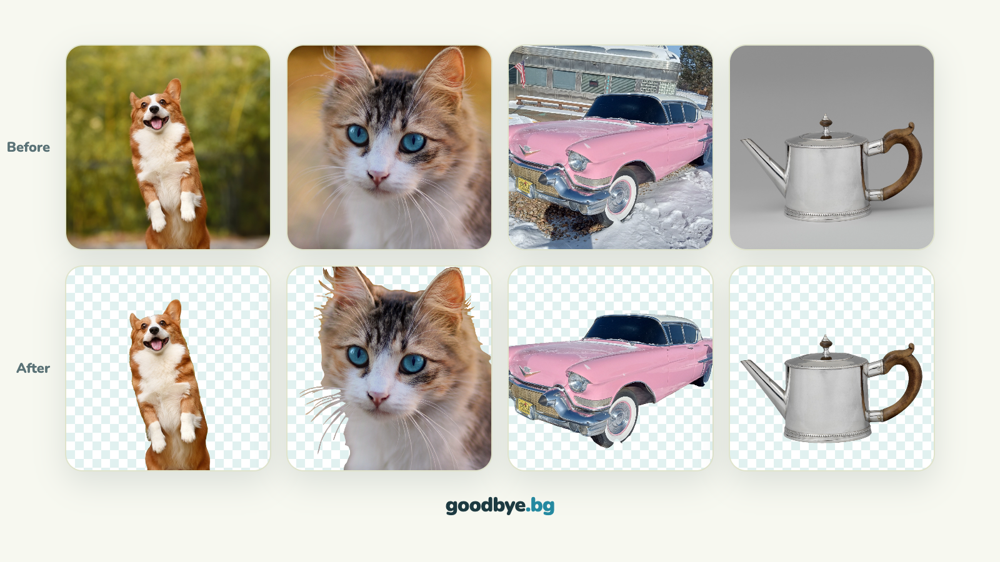

# goodbye.bg

A free background remover that cuts photos out in your browser, on your device.

<picture>
  <source media="(prefers-color-scheme: dark)" srcset="docs/launch/before-after-strip-dark.png">
  
</picture>

Live: https://goodbye.bg (it works offline after your first photo: the page and the model stay on the device).
Demo photos are CC0 (credits in [`docs/launch/CREDITS.md`](docs/launch/CREDITS.md)). The demo was recorded on an
M-series Mac with the model already cached.

I built it because remove.bg stops removing backgrounds on 1 December 2026.

- Free. No account, no watermark.
- PNG at the photo's own resolution, cropped to the subject.
- Up to 100 photos per drop on computers (50 on phones, tablets and computers that report less than 8 GB of memory),
  or a ZIP or folder. Download all gives a zip.
- Reads JPG, PNG, WebP, AVIF, SVG, HEIC, TIFF, camera RAW (its embedded JPEG preview), ZIPs and animated GIFs.
- English, German, Spanish, French, Brazilian Portuguese and Indonesian, following the browser's language.
- Not there: an API, an edge brush, new backgrounds.

## Why it is different

The model runs on your device. The page's Content-Security-Policy lets it talk to its own origin and no one else
(`src/_headers`), so the page has no way to send a photo to a third party. There are no cookies and no third-party
scripts or fonts.

Two things do reach our server, and both are described below under [Privacy](#privacy):

1. A link you paste. The image is on another site, so a small Cloudflare Pages Function fetches it for you.
2. The one exception: **if you click a Zazzle product card, that one result is uploaded** so it can appear on the
   product. Nothing else you do uploads a photo.

## How it works

`src/app.js` is the page. `src/engine.js` runs [ONNX Runtime Web](https://onnxruntime.ai) 1.31.1 inside its own
module Worker. The page sends RGBA pixels at 1024 x 1024; the worker builds the model's input (the 640 model boxes it
down), runs it and returns a mask, which is scaled back to the photo.

| Engine | Where | Model | Measured |
|---|---|---|---|
| GPU | Computers with WebGPU and `shader-f16` (and 8 GB or more, when the browser reports it) | BiRefNet lite, fp16, 93 MB, MIT | 280 to 300 ms a photo (M5 Pro, Chrome); GPU memory about +3.0 GB at peak |
| GPU | Phones and tablets with WebGPU; computers where BiRefNet fails or is too slow | IMG.LY ISNet medium, fp16, 88 MB, AGPL | 150 to 300 ms a photo (M5 Pro, Chrome) |
| CPU | Everything else (every iPhone and iPad), and the fallback | BiRefNet lite at 640 px, 95 MB, WebAssembly | 2.9 to 3.7 s inferred in headless Chrome with the iPhone user agent; 5 to 8 s a photo on a real iPhone (24 MP photos) |

The first photo needs about 120 MB (the model plus the 29 MB ONNX Runtime wasm); the browser keeps both. Computers start
the download when the page loads; phones at the first touch, or after 3 s on the page on a fast connection. Model
and runtime are served in parts because Cloudflare Pages caps a file at 25 MiB.

BiRefNet at 1024 on the CPU took 10 s and 6.7 GB in Node, so the CPU engine runs it at 640 (`weights/birefnet640/`,
made by `scripts/birefnet640.sh`). At 640 it loses some thin parts (legs, cables, frames) that ISNet keeps, so a 👎 on
a CPU result reruns the photo with ISNet at full size. After either BiRefNet, soft edges (hair, fur) are redrawn from
the photo with a guided filter (`refineEdge` in `src/app.js`); crisp edges stay.

### Making BiRefNet run on WebGPU

The onnx-community BiRefNet export did not run on WebGPU as shipped. Two scripts rewrite it (`scripts/birefnet.sh`
runs both; the committed weights in `weights/birefnet/` are the result):

1. **Wide Concat and Split ops.** WebGPU gives a shader 10 storage buffers; the model has Concats with up to 1024
   inputs and Splits with 8, 16 and 32 outputs. `scripts/narrow-onnx.py` rewrites them into trees of at most 6.
2. **Deformable convolutions.** The decoder's 20 deformable convs were exported as GatherND and Mul over every
   kernel tap at once: 392 MiB fp16 tensors for the 7x7, and `std::bad_alloc`. `scripts/deform-to-gridsample.py`
   replaces each with GridSample (bilinear, zeros padding, `align_corners=1`, which is what the export computes) over
   a few kernel rows at a time, a strided Conv per chunk, and a sum. No chunk is over 64 MB. The script asserts the
   export's base grid is "pixel + tap - centre" before it rewrites a block.

Checked against the unmodified model on the CPU with the same input: mean difference 0.0005, max 0.21, 0.04% of pixels
off by more than 0.1, none across 0.5. All 3820 nodes run on WebGPU. Details and side-by-side notes:
[`docs/birefnet.md`](docs/birefnet.md).

### GPU failures and the CPU fallback

A failed WebGPU run aborts ONNX Runtime's wasm instance for the whole realm, so the GPU engine lives in its own
Worker. The GPU worker does a warm-up run before "Ready" (it compiles the shaders and proves the GPU works). If the
GPU fails to start, fails a run, hangs (30 s for the warm-up, 15 s a run) or returns NaN, the page terminates that
worker and steps down: BiRefNet to ISNet on the GPU (also when BiRefNet takes over 10 s to start or over 2 s for its
first photo), ISNet on the GPU to the CPU, which redoes the photo. A step down is remembered on that device for 30 days
or until the browser, runtime or model changes. `?gpufail=init|run|hang` simulates each.

### iPhones and memory

- iPhones and iPads always use the CPU engine with 2 threads. On the tester's iPhone the WebGPU engine crashed the
  tab on the first real photo (one try in two); the CPU engine never crashed. 4 threads peaked at 2.1 GB in the
  Simulator and crashed an 18.75 MP photo half the time; 2 threads peak about 300 MB lower. BiRefNet at 640 peaks
  about 50 MB above ISNet (under 2.0 GB); on that iPhone, 5.3 to 8.3 s a photo, no crashes over a batch of 10.
- ISNet at 1024 x 1024 (the engine before 2026-11-22, and the 👎 retry on the CPU now) needs 1.5 to 2 GB of wasm heap, mostly activations, and cannot run smaller (a Concat inside is
  fixed to 1024). Asking for only the first of its 13 outputs, freeing the model bytes after the session is created,
  encoding one PNG at a time and compositing the mask instead of copying pixels took three photos from 2.1 GB to
  1.46 GB.
- iPhones shut the engine down once it is idle (its memory never shrinks; 7 to 8 photos in one tab crashed Safari).
- Safari caps canvases at 16 MP, so the original bitmap is kept and scaled when drawn.
- Safari only gives a page threads when it sends `Cross-Origin-Embedder-Policy: require-corp` (it ignores
  `credentialless`), so the site sends that.

### Photos are kept on your device

Photos, masks and crops are stored in IndexedDB, so a reload or a discarded phone tab does not lose them: the newest
50 photos within 1 GB on computers and 400 MB on phones, oldest out first. Removing a card deletes its copy. Safari
clears site storage after 7 days without a visit.

### Other pieces

- Animated GIFs: gifuct-js reads them, every frame (at most 100; 16 when the CPU engine runs them) goes through the
  model, gifenc writes a GIF with on/off transparency, so soft edges become hard.
- HEIC and TIFF (on browsers that do not open them) and camera RAW decode in a module Worker (`src/formats.js`) that
  is loaded only when needed: libheif 1.23.5 and UTIF.
- Ad products are drawn in 3D with Three.js, loaded only when ads show.

## Quality

Measured on 1,073 public photos from six datasets, with the two model files the site ships, scored against ground
truth and graded by eye. Full tables, method and the commands to repeat it: [`docs/quality-1000.md`](docs/quality-1000.md).

| | BiRefNet lite (computers, GPU) | ISNet (phones' GPU, the GPU step-down, the 👎 retry on the CPU) |
|---|---|---|
| Mean IoU, 923 photos with real masks | 0.960 | 0.894 |
| Photos at IoU 0.95 or better | 86% | 62% |
| Graded by eye (104 photos): good / usable / bad | 85 / 14 / 5 | 57 / 32 / 15 |

BiRefNet beat ISNet by more than 0.02 IoU on 357 photos; ISNet beat BiRefNet on 20. By dataset (BiRefNet, IoU):
portraits 0.990, animals 0.977, mixed 0.955, thin objects 0.923. BiRefNet at 640 (the CPU engine) was measured
separately: [`docs/phone-birefnet640.md`](docs/phone-birefnet640.md) and [`docs/quality-products.md`](docs/quality-products.md).

Weak spots:

- Hair is the hardest part. The models cut it as a solid shape; the guided filter after BiRefNet brings back soft
  edges (in a held-out check, 12 photos better and none worse), but flyaway strands are still lost.
- See-through objects fail on both (the 34 "transparent" photos score IoU 0.661 on BiRefNet, 0.450 on ISNet).
- ISNet often loses part of the subject (a dark body, white on white, a tail) or keeps blur around a close-up.
  BiRefNet's main flaw is choosing the subject where that is debatable (a blanket, hands, a collage).
- The test photos are not phone camera rolls: median 1.7 MP, mostly well lit, no low light. One grader graded by
  eye, once. BiRefNet may have seen some of the test photos in training. Not in these numbers: the retry on a
  thumbs down, GIFs.
- The 👎 button retries: on a computer, zoomed in on a small subject; on the CPU engine (phones), with ISNet over the whole photo. A second pass that zooms in on every photo was measured and made
  results worse, so it is not on.

## Privacy

What the page sends to its own server, and nothing else:

- **A rating**, when you press 👍 or 👎 (`/api/rate`): the vote, which engine, first try or retry, time taken and
  megapixels. In the other five languages, a one-time vote on the translation (the language and 👍 or 👎).
- **How each photo went** (`/api/rate`): done, failed, no subject found, downloaded, or all downloaded; the engine, how
  long the model took, how long from adding the photo to its result, megapixels (or how many photos) and device kind.
- **Crash and error reports** (`/api/crash`): if a tab died while working on a photo, the next visit sends the step,
  engine, device kind, photos done, megapixels and the last 20 step names. A GPU that fails or is too slow, and a script
  error in the page's own code (its file, line and message, at most 5 a visit), are sent at once. Never photo data.
- **A count** (`/api/count`): one is added to a single global number per finished photo. The footer reads it once
  on load.
- **A page view** (the first `/api/count` call): device kind, the referring site's hostname and the country.
- **A pasted link** (`/api/fetch`): the link is fetched and the bytes streamed back. Nothing is stored or logged.
- **A product card click** (`/go/<id>`): counts the click and redirects. A POST there counts the card being shown.

None of these carry an IP address or an identifier, and the site sets no cookies. `?debug=1` additionally sends step
names and numbers to `/api/diag`, which only writes to the server log; it is off unless you add it.

### The Zazzle exception

Clicking a Zazzle product card is the one case where a photo leaves your device. The page uploads the result shown
on that card (at most 2400 px) to `/api/cap/<random key>`, stored in a Cloudflare R2 bucket, then opens Zazzle's
Create-a-Product page with the image on the product. Zazzle copies the image on its first fetch, and our copy is
deleted 20 seconds after that (coming back to the product later still works: Zazzle keeps its copy). If Zazzle never fetches it, it is unreachable after an hour and a lifecycle rule clears
anything left after a day. The key is random and used once; nothing identifies you. If the upload fails, the card
opens the usual link and your computer saves the result instead. `?zazzlecap=0` turns the upload off. Notes:
[`docs/zazzle-cap.md`](docs/zazzle-cap.md).

## Ads and affiliate links

The site is free, and the product cards pay for it. They sit among the photos once the first one is done (one beside 1
to 3 photos, then one after every 6th, at most 3), are marked "Ad" or "Sponsored", are not in Download all and have no
rating.

- Zazzle is the active partner; the Zazzle links are affiliate links. A partner shows only when its affiliate
  link is set in `lib/partners.mjs` (Printful and Printify are listed there with no link yet, so they do not show).
- Links go through `/go/<id>`, which counts the click and redirects.
- Zazzle products are drawn from your own photo in a canvas on your device. Drawing one uploads nothing; see
  [the Zazzle exception](#the-zazzle-exception).
- A separate network slot (`src/ad.html`, a sandboxed iframe) is switched off (`ADS = false` in `src/app.js`).

To block the cards: they carry the class `adcard`, and an ad blocker hides them (a filter such as
`goodbye.bg##.adcard`). Blocking `/go/` stops the click and show counts. That is your choice and the site does
not work around it. Nothing else on the page depends on the cards.

## Run it locally

Needs Node. The build uses native packages, so install on the machine that runs it.

    npm ci
    npm run dev        # builds dist/ and serves it at http://localhost:8788 with the production headers
    npm run test       # builds, serves and drives the installed Google Chrome headless (or CHROME=/path/to/chrome)
    npm run test:x     # the same flows in WebKit and Firefox (Playwright's browsers: npx playwright install webkit firefox)

`npm run build` builds only; `npm run shoot` re-shoots the launch pictures and demo from a running `npm run dev`. The tests take about two and a half minutes. `scripts/serve.mjs` passes `/api/count`
through to the live site, so each photo in a test adds one to the public count.

The BiRefNet weights are committed in 20 MiB parts with a manifest (size, sha256); the build copies them to
`m/birefnet-<hash>/`. To regenerate them, run `scripts/birefnet.sh` (it needs Python with `onnx`). Test switches:
`?engine=gpu|cpu`, `?model=isnet|birefnet`, `?threads=N`, `?debug=1`.

Layout: `src/` (the static site), `functions/` (Cloudflare Pages Functions: `/api/*`, `/go/*`, `/cap/*`; the only
server code), `lib/partners.mjs`, `scripts/` (build, local server, tests, model rewrites, quality harness), `docs/`.
`CLAUDE.md` has the longer engineering notes.

## Licences

The code is **AGPL-3.0** ([`LICENSE`](LICENSE)). It is AGPL because ISNet's weights (IMG.LY, via
`@imgly/background-removal-data`) are, and the site still ships ISNet: on phones with WebGPU, as the step-down for a
computer GPU that can't run BiRefNet, and as the 👎 retry on the CPU. BiRefNet (MIT) runs everywhere else.

Third-party pieces:

- BiRefNet (Zheng Peng et al.), MIT: [`docs/licenses/BiRefNet.txt`](docs/licenses/BiRefNet.txt). The ONNX export
  comes from onnx-community and is rewritten by the scripts above.
- ISNet / IMG.LY background-removal-data 1.4.5, AGPL-3.0.
- ONNX Runtime Web 1.31.1 (MIT).
- Three.js 0.187.0 (MIT), libheif-js 1.23.5 with libheif (LGPL-3.0; the wasm is served with `libheif-LICENSE.txt`),
  utif2 (MIT), fflate (MIT), gifuct-js (MIT), gifenc (MIT), canvas-confetti (ISC), Nunito (SIL Open Font License).
- Quality datasets and their terms: [`docs/quality-1000.md`](docs/quality-1000.md). Launch photos: CC0.

Source: https://github.com/kevinebaugh/goodbye.bg
